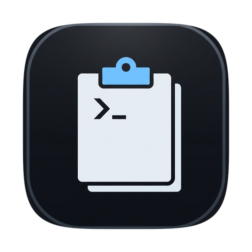
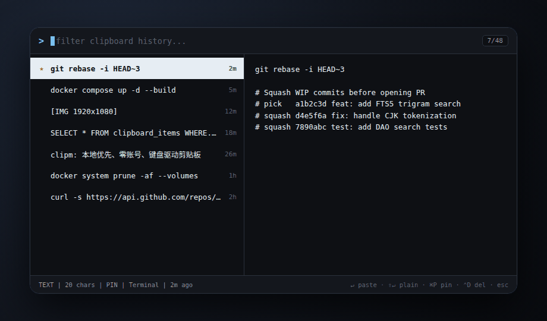

<p align="center">
  
</p>

# clipm

A local-first, zero-account, keyboard-driven desktop clipboard history manager inspired by Omarchy's high-contrast monospace aesthetic.

[](https://github.com/tubook/clipm/releases/latest)
[](https://github.com/tubook/clipm/releases/latest)
[](https://github.com/tubook/clipm/releases/latest)
[](https://github.com/tubook/clipm/actions/workflows/ci.yml)
[](LICENSE)

<p align="center">
  
</p>

## Features
- **100% Local**: SQLite (Drift) + FTS5 trigram full-text search (English & CJK substrings); images stored content-addressed under `<ApplicationSupport>/images/`.
- **Seamless Paste & Quick Slots**: Captures previous foreground window before showing overlay, writes back to OS clipboard with loop prevention, hides overlay, restores focus, and sends `Cmd+V` (macOS) / `Ctrl+V` (Windows). Instant quick-paste for top 9 items via `Cmd/Ctrl + 1~9`.
- **Type & Source Filtering**: Cycle `ALL / TXT / IMG / PIN` with `Tab` and filter by source application with `@app:<name>`.
- **Preferences & Privacy Controls**: Inline preferences (`Cmd+,` / `Ctrl+,`) persisted locally in `settings.json` — configurable global hotkey, capacity/retention limits, launch at login, pause monitoring (privacy mode), ignored app blacklist, and multi-monitor cursor-screen centering.
- **Sensitive Content Filtering**: Drops password-manager clipboard entries (`org.nspasteboard.ConcealedType` / `TransientType` on macOS; `ExcludeClipboardContentFromMonitorProcessing` / `CanIncludeInClipboardHistory` on Windows).
- **Auto Dedup & Capacity Limit**: SHA-256 deduplication; configurable unpinned item limit (default 500) and optional day-based expiration with automatic disk image cleanup.

## Keyboard Shortcuts
- `Cmd + Ctrl + V` (macOS) / `Win + Ctrl + V` (Windows): Toggle overlay globally (customizable in Preferences)
- `Up / Down` or `Ctrl + P / Ctrl + N`: Navigate history list
- `Enter` / `Shift + Enter`: Paste selected item (or force plain text)
- `Cmd + 1~9` (macOS) / `Ctrl + 1~9` (Windows): Quick-paste item 1–9 (add `Shift` for plain text)
- `Tab` / `Shift + Tab`: Cycle filter (`ALL` / `TXT` / `IMG` / `PIN`)
- `Cmd + P` (macOS) / `Ctrl + Shift + P` (Windows): Toggle Pin
- `Ctrl + D` (or `Delete` when search is empty): Delete selected item & local image
- `Cmd + ,` (macOS) / `Ctrl + ,` (Windows): Open inline Preferences
- `Esc`: Close Preferences or hide overlay and restore focus

## Build from Source

```bash
flutter pub get
dart run build_runner build
flutter build macos --release   # macOS
flutter build windows --release # Windows
```

### macOS First Launch Note
1. If Gatekeeper blocks the unsigned personal build, run: `xattr -cr /Applications/clipm.app`
2. Grant **Accessibility** permission when prompted so `CGEvent` can synthesize `Cmd+V`.

## Contributing

Contributions are welcome! Please read the [Contributing Guide](CONTRIBUTING.md) and [Code of Conduct](CODE_OF_CONDUCT.md) before opening an issue or pull request.

## Security

If you discover a security vulnerability, please do **not** open a public issue. See [SECURITY.md](SECURITY.md) for how to report it privately.

## Changelog

See [CHANGELOG.md](CHANGELOG.md) or [GitHub Releases](https://github.com/tubook/clipm/releases) for version history.

## License

This project is licensed under the [MIT License](LICENSE) — Copyright (c) 2026 tubook.

